# Worktro FP — 주요 화면 캡쳐 / Screen Captures

> 대상 / Target: `http://192.168.8.19:3000/` · v0.1.0
> 캡쳐일 / Captured: 2026-06-02 (admin 로그인 상태 / logged in as admin)
> 분석 본문 / Full analysis: [`../Analysis-FP.ko.md`](../Analysis-FP.ko.md) · [`../Analysis-FP.en.md`](../Analysis-FP.en.md)

뷰포트 / Viewport: 1280px · 풀페이지 캡쳐 / full-page screenshots

---

## 공개 / Public

### 01 · 랜딩 / Landing — `/`
히어로 + 3대 특징(1-Click 자동화 · 도메인 우선 · HW 적응). 소셜 로그인 버튼은 미구현.
Hero + 3 features (1-click automation · domain-first · HW adaptation). Social login disabled.

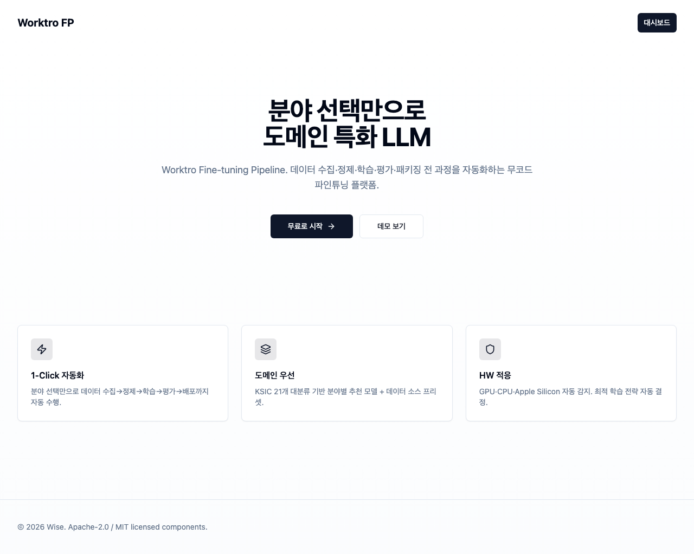

### 02 · 로그인 / Login — `/login`
이메일+비밀번호. Google/GitHub/Kakao 버튼 disabled(미구현).
Email+password. Google/GitHub/Kakao buttons disabled (unimplemented).

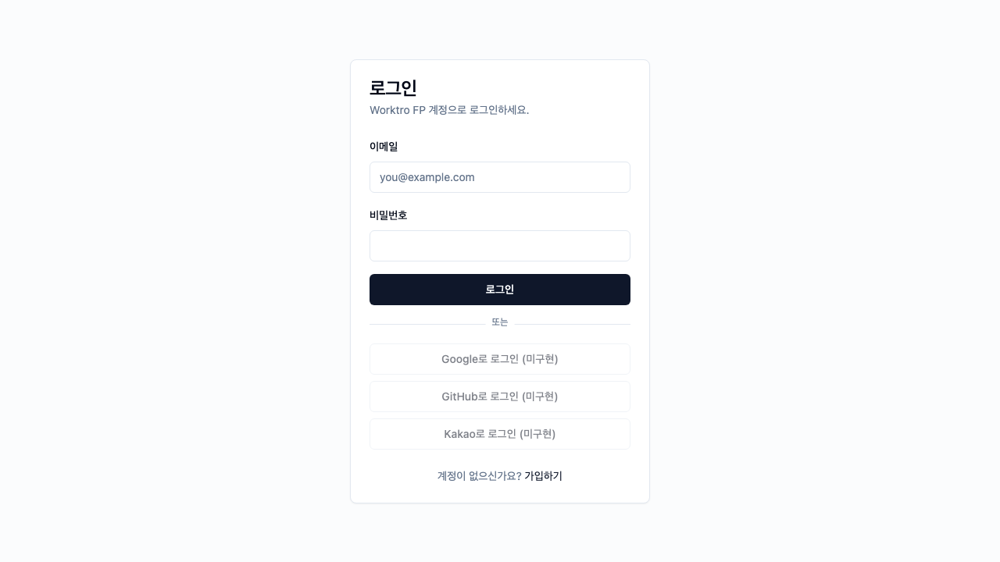

---

## 사용자 / User

### 03 · 대시보드 / Dashboard — `/dashboard`
시스템 리소스(CPU/GPU·VRAM/RAM·디스크) + 최근 잡 목록.
System resources (CPU/GPU·VRAM/RAM·disk) + recent jobs.

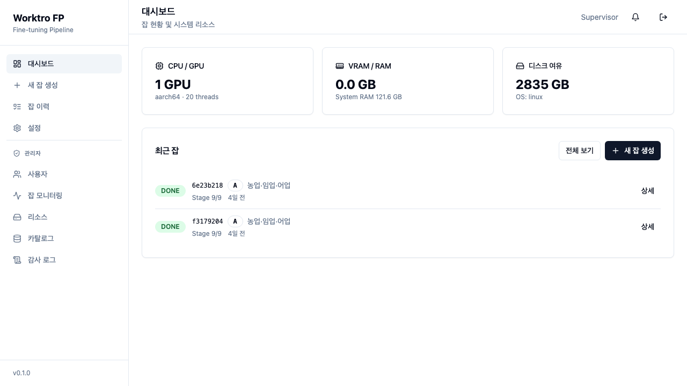

### 04 · 잡 이력 / Job History — `/jobs`
전체 잡 목록.
Full job list.

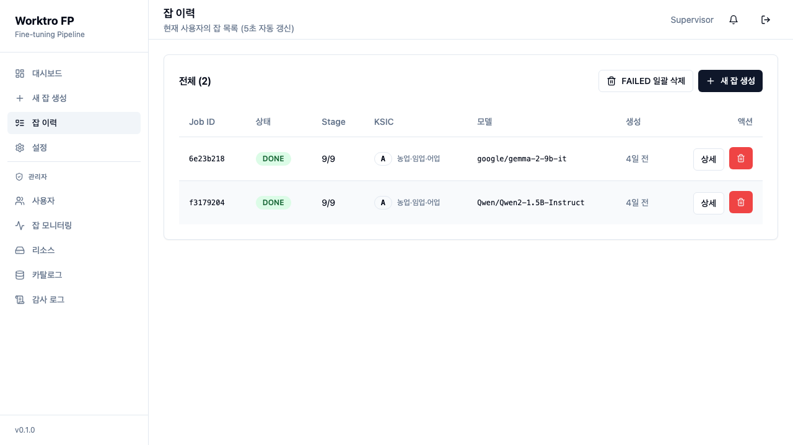

### 05 · 위자드 1 · 분야 선택 / Wizard 1 · Category — `/jobs/new/step-1-category`
KSIC 21개 대분류 + 태스크 타입 + 용도 설명.
21 KSIC divisions + task type + use-case description.

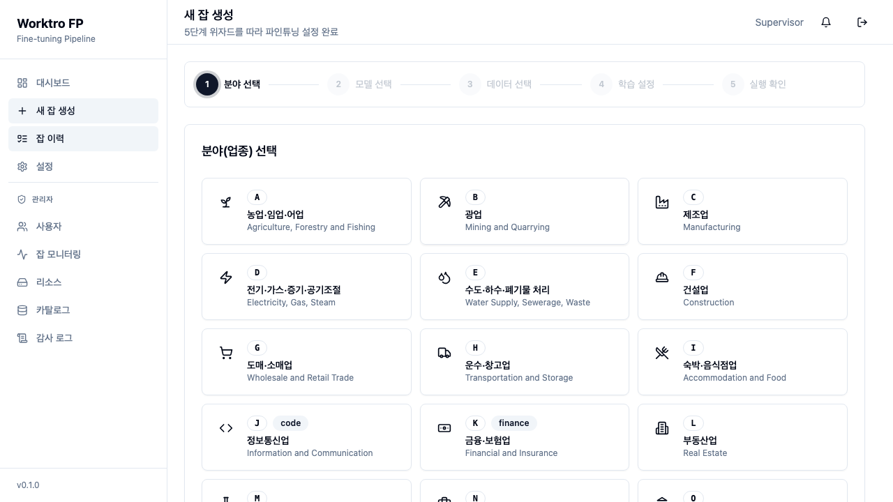

### 06 · 위자드 2 · 모델 선택 / Wizard 2 · Model — `step-2-model`
자동 선택(HW+카테고리 1순위) / 수동 선택. 적합도·VRAM·언어 표시.
Auto (HW+category top-1) / Manual. Shows fit %, VRAM, languages.

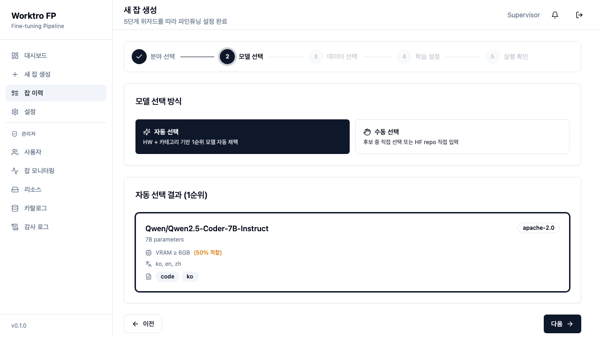

### 07 · 위자드 3 · 데이터 선택 / Wizard 3 · Data — `step-3-data`
소스(업로드/디렉토리/인터넷/합성) + 자동 정제 6단계 파이프라인.
Sources (upload/dir/internet/synthetic) + 6-stage auto-clean pipeline.

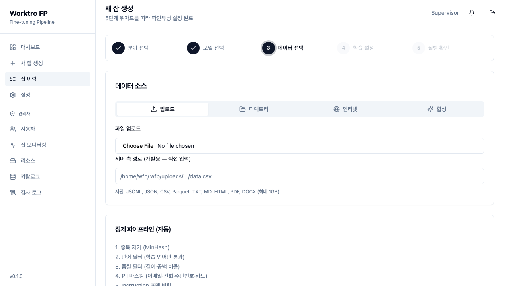

### 14 · 잡 상세 / Job Detail — `/jobs/{uuid}`
실시간 진행·로그, 탭(수집데이터/추론시연/다운로드), HF Hub 업로드(adapter/full · Private/Public), 학습 손실 차트.
Live progress·logs, tabs (collected/inference/download), HF Hub upload (adapter/full · Private/Public), training-loss chart.

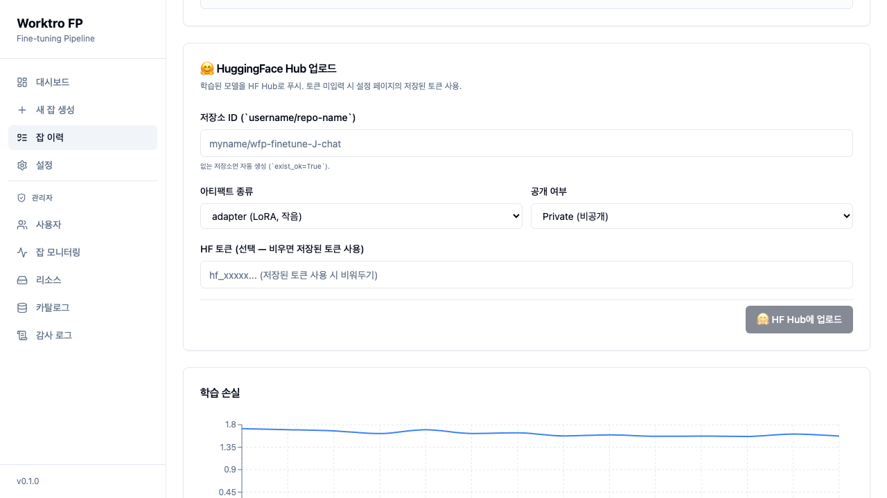

### 13 · 설정 / Settings — `/settings`
프로필 + HF 토큰(env HF_TOKEN 우선 > DB 저장값).
Profile + HF token (env HF_TOKEN priority > DB value).

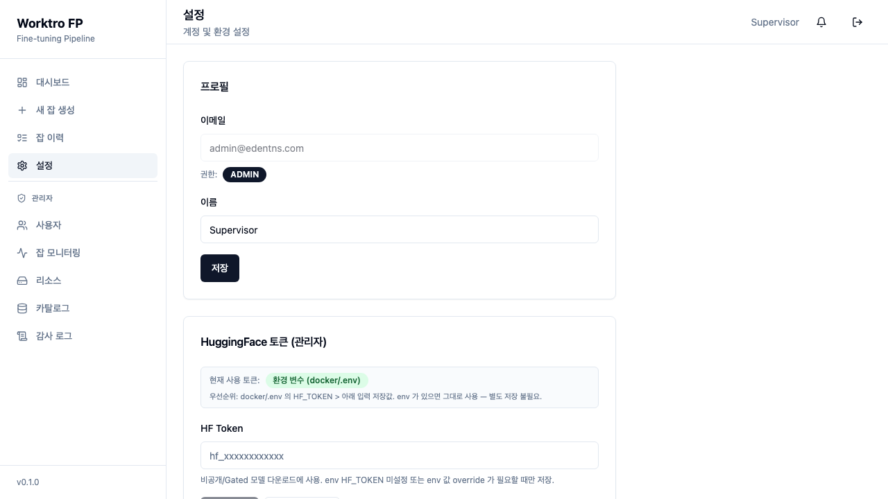

---

## 관리자 / Admin

### 08 · 카탈로그 / Catalog — `/admin/catalog`
모델 레지스트리(~16종) · 카테고리 프리셋 · 도메인 화이트리스트. HF 자동 갱신.
Model registry (~16) · category presets · domain whitelist. HF auto-refresh.

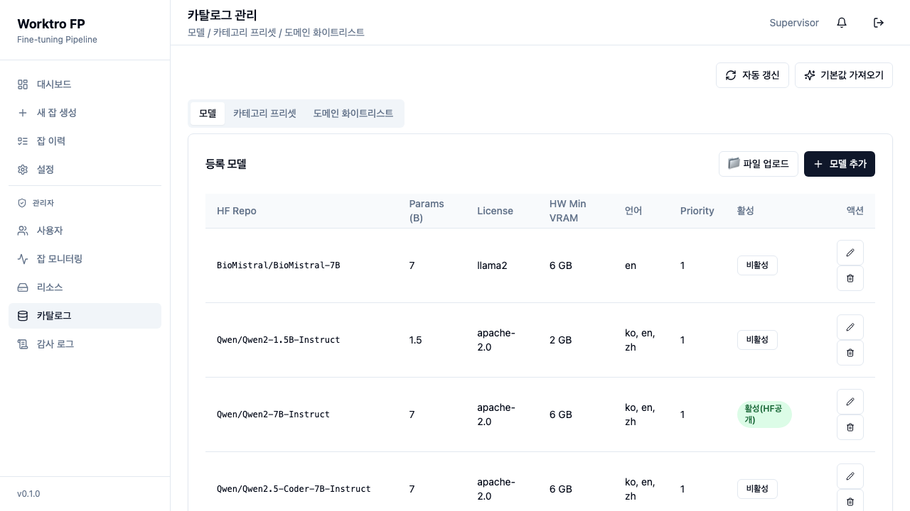

### 09 · 리소스 / Resources — `/admin/resources`
GPU(NVIDIA GB10) 사용률·VRAM·온도, 잡 큐, 디스크.
GPU (NVIDIA GB10) util·VRAM·temp, job queue, disk.

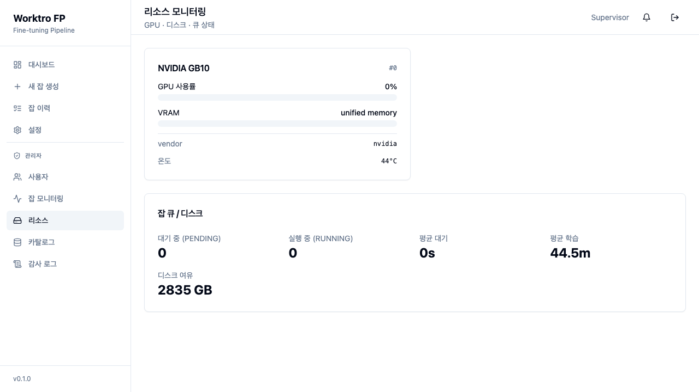

### 10 · 사용자 / Users — `/admin/users`
사용자 3명, RBAC(ADMIN/USER), 권한 변경·활성화.
3 users, RBAC (ADMIN/USER), role change·activation.

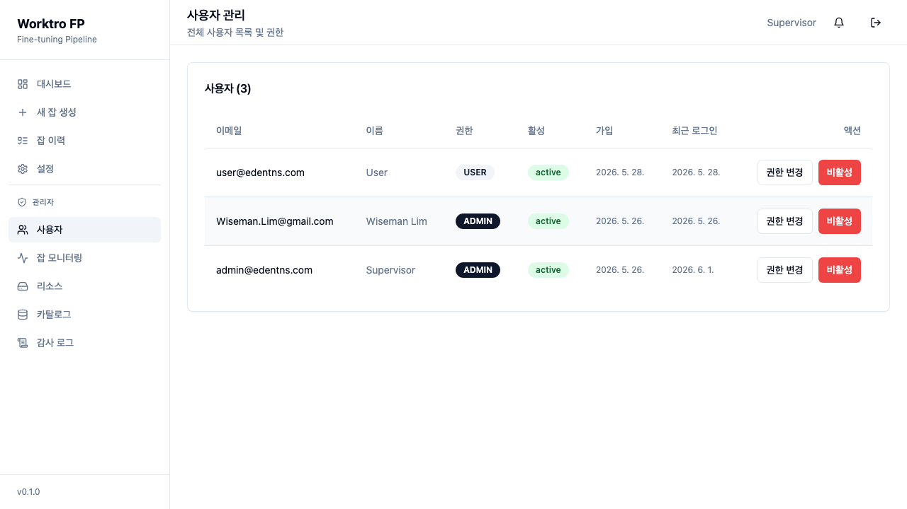

### 11 · 잡 모니터링 / Job Monitoring — `/admin/jobs`
전체 사용자 잡 + 상태 필터 + 강제 취소/삭제(파괴적, 경고 포함).
All-user jobs + status filter + force cancel/delete (destructive, warned).

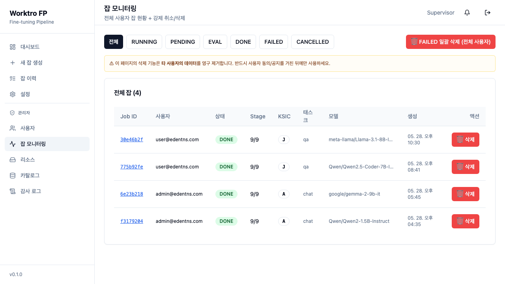

### 12 · 감사 로그 / Audit Log — `/admin/audit`
관리자 액션 이력(catalog seed/delete/patch/download, auto_refresh 등) 22건.
Admin action history (catalog seed/delete/patch/download, auto_refresh, etc.) — 22 entries.

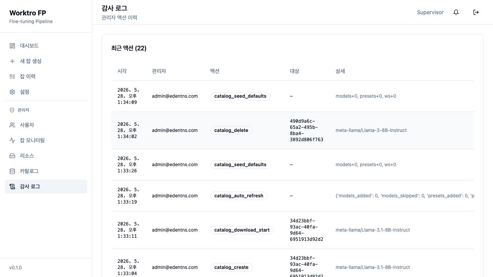
